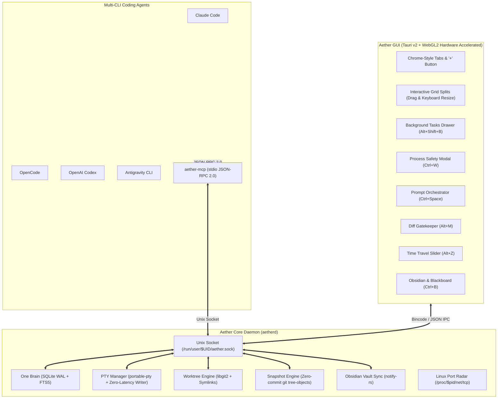

# ⚡ AetherTerminal

> **Multi-CLI Agentic Coding Orchestration Terminal with Shared Collective Memory ("One Brain"), Chrome-Style Multitab Headers, Background Terminals, Git Worktree Isolation, and Bi-directional Obsidian Vault Sync.**

AetherTerminal is a lightweight, high-performance Linux GUI terminal emulator purpose-built for concurrent multi-agent development (`claude-code`, `opencode`, `codex`, `antigravity`, `hermes`, etc.). Built with an asynchronous Rust core daemon (`aetherd`), Tauri v2 + WebKitGTK 4.1 frontend, and Xterm.js with WebGL2 hardware acceleration, AetherTerminal provides sub-3ms latency, zero-latency keystroke streaming, and operates under 80MB idle RAM.

---

## 🌟 Key Architectural Pillars



### 1. Chrome-Style Multitab & Window Resizing
- **Header Tabs Strip**: Integrated directly into the top bar with active status indicators, double-click inline renaming, and a dedicated `+` button.
- **Interactive Mouse Resizing**: Drag split dividers with visual cyan grips to freely resize terminal panes; double-click any divider to reset to a 50/50 balance.
- **Proportional Leaf Balancing**: Auto-balances window splits equally across all children (33%/33%/33% for 3 panes instead of unbalanced 50%/25%/25%).

### 2. Background Terminal System & Safe Detach
- **Background Tasks Drawer**: Launch asynchronous tasks (`cargo watch`, `npm run dev`, `docker compose up`) in the background via <kbd>Alt</kbd> + <kbd>Shift</kbd> + <kbd>B</kbd>.
- **Pane Detach**: Send any active terminal pane into the background with <kbd>Alt</kbd> + <kbd>B</kbd> to keep it running uninterrupted.
- **Attach to Grid**: Easily re-attach background tasks to your active layout or pop them out into dedicated tabs.
- **Port Radar**: Real-time inspection of `/proc/<pid>/net/tcp` to detect local dev servers (`:3000`, `:5173`) automatically.

### 3. Foreground Process Safety (`Ctrl+W`)
- Protects ongoing builds and agent executions by checking Linux child process trees (`/proc/{pid}/task/{pid}/children`).
- Pressing <kbd>Ctrl</kbd> + <kbd>W</kbd> while a task is running triggers a confirmation dialog with options to either safely detach to background or force-terminate.

### 4. Collective Memory ("One Brain")
- Embedded SQLite engine in **WAL (Write-Ahead Logging)** mode with **FTS5** full-text search.
- Shared Blackboard for real-time inter-agent communication: architectural decisions, API contracts, task claims, and handoffs.
- Advisory file-locking protocol to detect and prevent merge conflicts across parallel agents before code is modified.

### 5. Git Worktree Isolation & Context Bridge
- Automatic Git worktree creation under `.aether/worktrees/<agent-id>`.
- Shared dependency symlinking (`node_modules`, `target`, `.venv`, `.cargo`) to eliminate disk bloat and duplicate package downloads.
- Automatic generation of `.aether/context_bridge.md` providing running agents with real-time project constraints and peer activities.

### 6. Multi-Agent Squash-Merge Gatekeeper (`Alt+M`)
- Three-way tree merge analysis with conflict detection.
- Unified colorized diff viewer in the GUI.
- One-click atomic squash merge into `master` / `main` with automatic worktree branch cleanup and lock releases.

### 7. Zero-Commit Time Travel Snapshots (`Alt+Z`)
- Microsecond snapshot creation using Git plumbing tree objects (`git write-tree`) without polluting commit history.
- Non-destructive rollback slider enabling instant recovery if an agent hallucinates or breaks a build.

### 8. Bi-directional Obsidian Vault Sync (`Ctrl+B`)
- Synchronizes with `.aether/vault/` via `notify-rs` file watcher.
- In-terminal Sprint Runner: parses `- [ ]` and `- [x]` markdown checklists. Toggling a task checkbox in the GUI updates the vault note and broadcasts to all running agents.

---

## ⌨️ Global Keybindings

| Keybinding | Action | Description |
|---|---|---|
| `Ctrl+T` | **New Tab** | Create a new terminal tab in the Chrome header |
| `Ctrl+W` / `Alt+W` | **Safe Close Pane** | Close active pane (with safety check if a program is running) |
| `Ctrl+Shift+W` | **Close Tab** | Close the current tab and all its panes |
| `Ctrl+Tab` / `Ctrl+Shift+Tab` | **Cycle Tabs** | Switch between open tabs |
| `Alt+1` ... `Alt+9` | **Switch Tab** | Jump directly to tab 1 through 9 |
| `Alt+H` / `J` / `K` / `L` | **Vim Navigation** | Move focus between split panes (or use `Alt+Arrows`) |
| `Alt+Shift+H` / `L` | **Resize Width** | Expand or shrink pane width from keyboard |
| `Alt+Shift+J` / `K` | **Resize Height** | Expand or shrink pane height from keyboard |
| `Alt+E` | **Balance Panes** | Equalize all split panes proportionally |
| `Alt+B` | **Detach to Background** | Send active pane to background without stopping its process |
| `Alt+Shift+B` | **Background Drawer** | Open the Background Terminals drawer |
| `Alt+V` | **Split Vertical** | Split active terminal pane vertically |
| `Alt+S` | **Split Horizontal** | Split active terminal pane horizontally |
| `Ctrl+Space` | **Prompt Orchestrator** | Broadcast prompt to all active agents or targeted sub-groups |
| `Alt+M` | **Diff Gatekeeper** | Inspect unmerged worktree diff and squash-merge to main |
| `Alt+Z` | **Time Travel Slider** | Scroll through zero-commit checkpoints and rollback state |
| `Ctrl+B` | **Collective Memory** | Toggle Shared Blackboard activity feed & Obsidian Sprint Runner |

---

## 🛠️ Built-in MCP Tools (`aether-mcp`)

The local MCP server communicates with CLI agents via standard JSON-RPC 2.0 over `stdio`:

| Tool Name | Parameters | Purpose |
|---|---|---|
| `get_shared_context` | `workspace_id`, `query?` | Retrieve peer agent statuses, active file locks, and blackboard notes |
| `publish_blackboard` | `title`, `content`, `entry_type`, `target?` | Broadcast architectural decisions, API schemas, or bug reports |
| `claim_module` | `files[]`, `intent?` | Claim advisory locks on files before editing to prevent conflicts |
| `release_module` | `files[]` | Release locks after completing changes |
| `create_snapshot` | `summary` | Capture zero-commit checkpoint before high-risk changes |
| `read_obsidian_note` | `query_or_path` | Read project docs and sprint notes from `.aether/vault` |
| `update_obsidian_task` | `note_path`, `task_text`, `completed` | Toggle checklist items in sprint notes |

---

## 🚀 Quick Start

### Prerequisites
- **Linux** (Arch, Fedora, Ubuntu/Debian) with X11 or Wayland
- **Rust Toolchain**: `cargo`, `rustc` (1.80+)
- **WebKitGTK**: `webkit2gtk-4.1` (`libwebkit2gtk-4.1-dev` on Debian/Ubuntu, `webkit2gtk-4.1` on Arch)
- **Node.js / Bun**: For compiling the frontend React bundle

### 1. Build from Source
```bash
# Clone the repository
git clone https://github.com/Rasshqa/Aether.git
cd Aether

# Build frontend UI bundle
cd ui
bun install
bun run build
cd ..

# Build Rust binaries in release mode
cargo build --release --workspace

# Install desktop entry and icons
./bin/aether install-desktop
```

### 2. Launch AetherTerminal
```bash
# Launch daemon and GUI
./bin/aether

# Launch Claude Code directly with Aether One Brain MCP injected:
./bin/aether claude

# Launch OpenCode with One Brain MCP:
./bin/aether opencode
```

---

## 📂 Repository Layout

```
.
├── bin/
│   ├── aether              # Unified CLI launcher & daemon supervisor
│   ├── aether-claude       # Claude Code CLI wrapper with MCP injection
│   ├── aether-opencode     # OpenCode CLI wrapper
│   ├── aether-codex        # Codex CLI wrapper
│   ├── aether-antigravity  # Antigravity CLI wrapper
│   └── aether-hermes       # Hermes Agent wrapper
├── config/
│   ├── default_agents.toml # Declarative agent profiles configuration
│   └── default_theme.toml  # Theme & keybindings configuration
├── crates/
│   ├── aether-protocol/    # Shared types, IPC codec, Agent schemas & MCP contracts
│   ├── aetherd/            # Core daemon: SQLite WAL brain, PTY manager, Git engine
│   ├── aether-mcp/         # Standalone stdio JSON-RPC 2.0 MCP server
│   └── aether-gui/         # Tauri v2 native GUI host with WebKitGTK 4.1
├── packaging/
│   ├── desktop/            # Freedesktop .desktop entry and app icons
│   └── systemd/            # aetherd.service systemd user unit
├── ui/                     # React 18 + TypeScript + Tailwind CSS + Xterm.js WebGL2
│   ├── src/
│   │   ├── components/     # ChromeHeaderTabs, TerminalGrid, BackgroundTasksDrawer, Modals
│   │   ├── stores/         # Reactive split-pane state, tabs, background tasks & IPC bridge
│   │   └── main.tsx        # Application root layout
│   └── vite.config.ts
├── Cargo.toml              # Rust workspace resolver
├── CHANGELOG.md            # Release version history
├── CODE_OF_CONDUCT.md     # Community guidelines
├── CONTRIBUTING.md         # Developer contribution guide
├── LICENSE                 # MIT License
├── README.md               # Project documentation
└── SECURITY.md             # Security and vulnerability reporting policy
```

---

## 📄 License
Licensed under the [MIT License](LICENSE).
